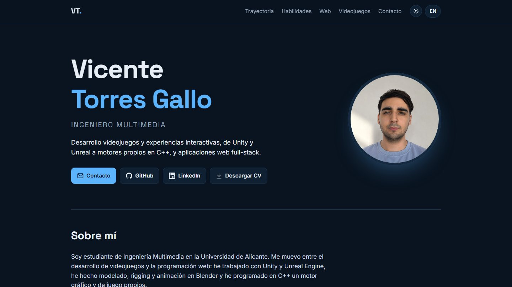

# Vicente Torres Gallo · Portfolio

Ingeniero Multimedia por la Universidad de Alicante. Desarrollo **videojuegos y experiencias interactivas** (Unreal Engine, Unity, C++) y **aplicaciones web full-stack** (Angular, Node, React).

**[Ver la web](https://vicente-torres-gallo.vercel.app)** · **[CV en PDF](public/cv/Vicente-Torres-Gallo-CV-ES.pdf)** ([English](public/cv/Vicente-Torres-Gallo-CV-EN.pdf)) · **[LinkedIn](https://www.linkedin.com/in/vicente-torres-gallo-353501264)** · vicentorresgallo@gmail.com



## Proyectos destacados

| Proyecto | Qué es | Tecnología |
|---|---|---|
| [EscAPE](https://vicente-torres-gallo.vercel.app/proyectos/escape-vr/) | Experiencia de realidad virtual para Meta Quest 3 (individual) | Unreal Engine 5.5, Blueprints, C++ |
| [Escape Room Lab](https://vicente-torres-gallo.vercel.app/proyectos/escape-room-lab/) | Escape room 3D con puzles de físicas, prueba técnica para Virtual Zone | Unity 6, C#, Blender |
| [Bubble Buddies](https://vicente-torres-gallo.vercel.app/proyectos/bubble-buddies/) | 🏆 1.er puesto en la GameJam Alicante 2025: plataformas controlado con la voz | Unity, Blender |
| [Donut Panic!](https://vicente-torres-gallo.vercel.app/proyectos/donut-panic/) | FPS sobre un motor gráfico y de juego propios, en equipo de 5 | C++, motor propio |
| [Forgotten Wonders](https://vicente-torres-gallo.vercel.app/proyectos/forgotten-wonders/) | RPG con combates por minijuegos y enemigos con A* | C++, SFML |
| [Cosmic Muncher](https://vicente-torres-gallo.vercel.app/proyectos/cosmic-muncher/) | Juego para la Game Boy original con motor ECS | Ensamblador |
| [Registro de Fichajes](https://vicente-torres-gallo.vercel.app/proyectos/registro-fichajes/) | App multiplataforma de control horario con geolocalización | Angular, Ionic, Node, MySQL |
| [ToDo App + microservicios](https://vicente-torres-gallo.vercel.app/proyectos/todo-app/) | SPA con API REST y autenticación JWT | Angular, Express, MongoDB |

Cada proyecto tiene en la web su página con descripción, mi rol, galería y vídeo.

## Sobre esta web

Hecha con **Next.js 16** (App Router), **React 19** y **TypeScript**, exportada como web estática y publicada en **Vercel**. Sin librerías de componentes ni de estilos: CSS propio con variables.

- **Contenido separado del diseño:** proyectos, perfil y textos viven en archivos de datos tipados (`data/`). Añadir un proyecto es añadir un objeto; la tarjeta, su página y la navegación se generan solas.
- **Bilingüe sin librerías:** español e inglés con un diccionario tipado y un store de React (`useSyncExternalStore`) que recuerda el idioma.
- **Modo claro y oscuro sin parpadeo:** un script mínimo aplica el tema guardado (o el del sistema) antes de pintar la página.
- **CV generado desde los mismos datos:** `/curriculum/es` y `/curriculum/en` son páginas A4 que se imprimen a PDF, así que la web y el CV no se desincronizan.
- **Páginas de proyecto estáticas** con `generateStaticParams`, galería con visor (`<dialog>` nativo) y vídeos de YouTube incrustados sin cookies.
- **Diseño adaptado a móvil** y accesible: navegación por teclado, `aria-*` y respeto a `prefers-reduced-motion`.

```
app/            Rutas: portada, /proyectos/[slug] y /curriculum/[lang]
components/     Tarjetas, página de proyecto, navegación, idioma y tema
data/           Contenido: perfil, proyectos, CV y textos de la interfaz
public/         Imágenes de los proyectos y PDF del CV
```

## Ejecutar en local

```bash
npm install
npm run dev
```

Abre <http://localhost:3000>.
